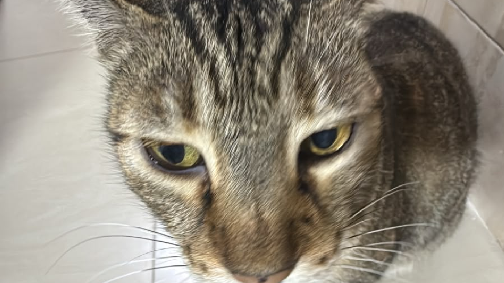

<p align="center">
  
</p>

#  Descargador de YouTube Personalizado (MP4 / MP3)

Herramienta ligera, interactiva y de código abierto en Python para descargar videos de YouTube en formato **MP4** o extraer su audio en **MP3 / M4A**, con selección de calidad, estimación de peso y gestión de carpetas de descarga personalizadas.

---

##  Características

-  **Video completo (Video + Audio):** Descarga en máxima calidad (1080p, 720p, etc.) combinando el video y audio en un archivo `.mp4` estándar.
-  **Solo video (Sin audio):** Descarga únicamente la pista visual en formato `.mp4`.
-  **Solo audio:** Extrae y convierte el audio a **MP3** (320, 256, 192, 128 o 64 kbps) o descarga el **M4A / AAC original** sin reconversión.
-  **Detección real de calidades:** Muestra todas las resoluciones disponibles del video junto a sus fotogramas por segundo (`fps`) y tamaño aproximado en MB/GB.
-  **Gestión de carpetas flexible:**
  - Guarda por defecto en la carpeta `Descargas` dentro del proyecto.
  - Permite configurar una **carpeta personalizada** pegando la ruta o seleccionándola con una ventana del explorador de Windows.
  - Recuerda automáticamente la última carpeta configurada (`config.json`).
  - Permite volver a la carpeta por defecto en cualquier momento con un clic.
-  **FFmpeg integrado automáticamente:** Gracias a `static-ffmpeg`, no necesitas descargar ni configurar manualmente herramientas externas en tu sistema.
-  **Acceso directo en el Escritorio:** Posibilidad de crear un acceso directo con nombre e ícono personalizado (`img/icono.ico`) durante la instalación.

---

##  Método 1: Instalación Automática (1 Clic)

> **Recomendado para usuarios sin experiencia con terminales o Python.**

1. **Descarga o descomprime** este proyecto en tu computadora.
2. Haz doble clic en el archivo **`instalar.bat`**.
   - *¿No tienes Python instalado?* El instalador lo detectará y te preguntará si deseas instalarlo de forma automática y segura a nivel de usuario (sin permisos de administrador).
   - Creará el entorno virtual (`venv`) e instalará las dependencias necesarias.
   - Te preguntará si deseas crear un **acceso directo en el Escritorio** llamado **`descarga YT`** con su ícono personalizado.
3. ¡Listo! Para usar la aplicación en cualquier momento, solo haz doble clic en:
   - El acceso directo **`descarga YT`** de tu Escritorio, o
   - El archivo **`iniciar.bat`**.

---

##  Método 2: Instalación Manual (Desarrolladores)

Si prefieres configurar el entorno por tu cuenta desde la terminal:

### Requisitos previos
- **Python 3.10** o superior instalado en el sistema.
- Terminal (PowerShell o CMD).

### Paso 1: Clonar o situarse en la carpeta del proyecto
```bash
cd "ruta/a/descargar yt"
```

### Paso 2: Crear el entorno virtual
```bash
python -m venv venv
```

### Paso 3: Activar el entorno virtual
- **En Windows (PowerShell):**
  ```powershell
  .\venv\Scripts\Activate.ps1
  ```
  *(Si PowerShell bloquea la ejecución de scripts, ejecuta antes: `Set-ExecutionPolicy -Scope Process -ExecutionPolicy Bypass`)*

- **En Windows (CMD):**
  ```cmd
  venv\Scripts\activate.bat
  ```

### Paso 4: Instalar las dependencias
```bash
pip install -r requirements.txt
```

### Paso 5: Ejecutar la aplicación
```bash
python main.py
```

---

##  Uso de la Aplicación

Al abrir la aplicación (mediante el acceso directo, `iniciar.bat` o `python main.py`), verás el menú principal:

```text
============================================================
          DESCARGADOR DE YOUTUBE PERSONALIZADO
============================================================
 Carpeta actual de guardado:
   C:\TuRuta\descargar yt\Descargas
============================================================

Menú principal:
 [1] Descargar video
 [2] Carpeta personalizada
 [3] Reiniciar carpeta (carpeta por defecto)
 [4] Salir
```

1. **Descargar video:** Pega el enlace de YouTube y sigue las instrucciones en pantalla para elegir qué pista descargar y en qué calidad.
2. **Carpeta personalizada:** Escribe/pega la ruta donde quieras guardar tus descargas, o presiona `v` para seleccionarla cómodamente con el explorador de archivos.
3. **Reiniciar carpeta:** Vuelve a fijar la carpeta `Descargas` del proyecto.
4. **Salir:** Cierra la aplicación y libera toda la memoria consumida.

---

##  Estructura del Proyecto

```text
├── img/
│   ├── banner.png       # Banner ilustrativo para la documentación
│   └── icono.ico        # Ícono oficial para el acceso directo
├── main.py              # Script principal con la lógica y menús
├── requirements.txt     # Dependencias necesarias (yt-dlp, static-ffmpeg)
├── iniciar.bat          # Lanzador rápido de un clic
├── instalar.bat         # Instalador automático con opción de acceso directo
├── .gitignore           # Exclusiones automáticas para Git
└── README.md            # Documentación del proyecto
```

> [!NOTE]
> Al ejecutar el programa se crearán automáticamente:
> - `venv/`: Entorno virtual local con las librerías.
> - `Descargas/`: Carpeta donde se guardan los videos/audios.
> - `config.json`: Archivo local que recuerda tu última carpeta de guardado.
>
> Ninguno de estos tres elementos debe subirse a GitHub ni compartirse con otras personas, ya que el archivo `.gitignore` los excluye por defecto.
