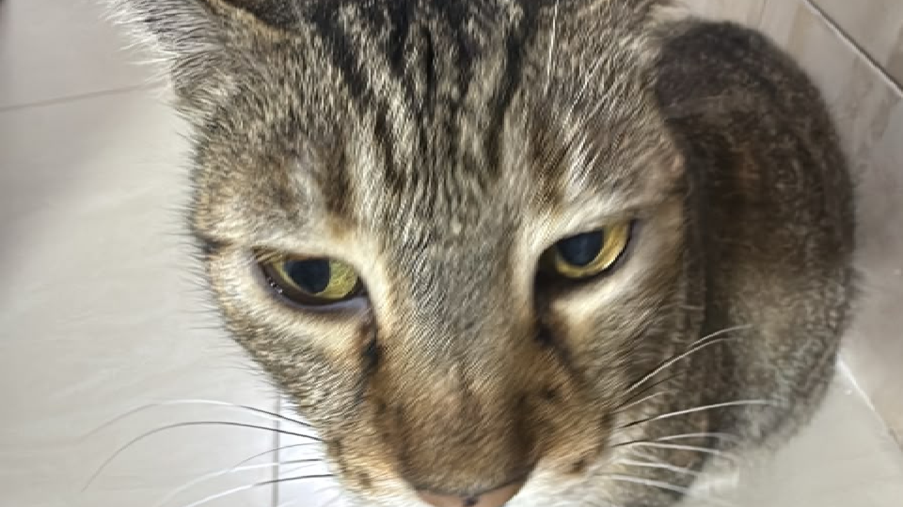

<p align="center">
  
</p>

# Descargador YT Studio (GUI en Flet • MP4 / MP3)

Aplicación de escritorio moderna para Windows desarrollada en **Python** con **Flet**, impulsada por `yt-dlp` y **FFmpeg integrado**. Permite analizar enlaces de YouTube, previsualizar miniatura y metadatos, estimar el peso exacto antes de descargar y guardar videos o audio en máxima calidad desde una interfaz oscura minimalista con acentos rosados en gradiente.

---

## Características

- **Interfaz gráfica moderna (Flet Desktop):** Diseño en modo oscuro con tarjetas flotantes, bordes redondeados, degradados rosados y un indicador de estado luminoso en la barra superior.
- **Análisis rápido sin bloquear la ventana:** Ejecuta la extracción de metadatos en segundo plano (`threading`) y muestra una tarjeta de previsualización con:
  - Miniatura en alta calidad y badge de duración (`mm:ss` / `hh:mm:ss`).
  - Título del video, nombre del canal y resolución máxima detectada.
- **Pegado inteligente:** Botón **Pegar** que lee el portapapeles e inicia el análisis automáticamente si detecta un enlace de YouTube.
- **Tres modos de descarga:**
  - **Video + Audio (`MP4` combinado):** Descarga video y audio en la mejor compatibilidad/calidad disponible (4K, 2K, 1080p, 720p, etc.) y los une automáticamente.
  - **Solo Audio:** Extrae y convierte el audio a **MP3** (320, 256, 192, 128 o 64 kbps) o descarga el **M4A / AAC original** nativo sin reconversión.
  - **Solo Video (`MP4` sin audio):** Descarga únicamente la pista visual en la resolución elegida.
- **Peso estimado y calidades reales:** Muestra todas las resoluciones disponibles (`fps` y etiqueta HD/Full HD/2K/4K) junto al peso aproximado exacto antes de iniciar la descarga.
- **Progreso en tiempo real y cancelación segura:** Barra de progreso con gradiente que muestra porcentaje, velocidad de descarga (`MB/s` / `KB/s`), tiempo restante estimado (`ETA`), progreso acumulado en MB, botón **Cancelar** para abortar descargas en curso limpiando automáticamente archivos temporales (`.part` / `.ytdl`) y acceso directo para abrir el archivo al finalizar.
- **Actualizador integrado de `yt-dlp`:** Botón en la barra superior para verificar e instalar en un clic la versión más reciente del motor `yt-dlp` tanto en modo código fuente como en el instalador `.exe`.
- **Nombres de archivo compatibles con Windows:** Saneamiento automático de caracteres especiales y longitud máxima de ruta (`windowsfilenames` y `trim_file_name`).
- **Gestión de carpetas flexible (`config.json`):**
  - Guarda por defecto en la carpeta `Descargas` dentro de la aplicación.
  - Permite cambiar la carpeta mediante el explorador nativo de Windows, restablecerla a la predeterminada o abrirla directamente en un clic.
- **100% Autónomo (FFmpeg integrado):** Tanto en el instalador `.exe` como desde el código fuente (`static-ffmpeg`), no necesitas descargar ni configurar herramientas externas.

---

## Método 1: Instalador Directo de Windows (`Setup.exe` - Releases)

> **La forma más rápida y sencilla. No requiere tener Python ni FFmpeg instalados.**

1. Ve a la sección de [**Releases**](../../releases) de este repositorio en GitHub.
2. Descarga el archivo **`DescargadorYT_Setup.exe`**.
3. Ejecuta el instalador, marca la casilla **"Crear un icono en el escritorio"** y finaliza el asistente.
4. ¡Listo! Abre la aplicación desde el acceso directo **`Descargador YT`** en tu Escritorio o desde el Menú Inicio de Windows.

---

## Método 2: Instalación Automática desde el Código Fuente (`instalar.bat`)

Si descargaste o clonaste el repositorio con el código fuente:

1. Haz doble clic en el archivo **`instalar.bat`**.
   - *¿No tienes Python instalado?* El script lo detectará y te ofrecerá instalarlo automáticamente a nivel de usuario.
   - Creará el entorno virtual (`venv`) e instalará las dependencias necesarias (`yt-dlp`, `static-ffmpeg` y `flet[desktop]`).
   - Te preguntará si deseas crear un acceso directo en el Escritorio con su ícono personalizado.
2. Para abrir la aplicación en cualquier momento, haz doble clic en el acceso directo o en **`iniciar.bat`**.

---

## Método 3: Instalación Manual y Compilación (Desarrolladores)

### Requisitos previos
- **Python 3.10** o superior instalado en el sistema.
- Terminal (PowerShell o CMD).

### Ejecutar en modo desarrollo
```powershell
# 1. Crear el entorno virtual
python -m venv venv

# 2. Activar el entorno virtual (PowerShell)
.\venv\Scripts\Activate.ps1

# 3. Instalar las dependencias
pip install -r requirements.txt

# 4. Ejecutar la aplicación
python main.py
```

### Generar un nuevo instalador `DescargadorYT_Setup.exe` para GitHub Releases
El proyecto incluye automatización completa con **Flet Pack (PyInstaller)** e **Inno Setup 6**:
- Haz doble clic en **`empaquetar.bat`**
- El script compilará la aplicación junto con los binarios de FFmpeg e íconos, y generará el instalador final listo para distribuir en:
  ```text
  release/DescargadorYT_Setup.exe
  ```

---

## Uso de la Aplicación

Al abrir **Descargador YT Studio**:

1. **Carpeta de destino:** En la barra superior puedes ver la ruta activa donde se guardarán tus archivos, junto a los botones **Cambiar**, **Restablecer** (`Descargas/`) y **Abrir carpeta**.
2. **Enlace y análisis:** Pega la URL de YouTube manualmente o usa el botón **Pegar** y haz clic en **Analizar** (o presiona `Enter`).
3. **Previsualización y configuración:** Revisa la tarjeta del video detectado, elige el modo (**Video + Audio**, **Solo Audio** o **Solo Video**) y selecciona la calidad deseada en el menú desplegable verificando el **Peso estimado**.
4. **Descargar y seguir el progreso:** Haz clic en **Descargar ahora**. Podrás monitorear el avance en tiempo real (porcentaje, velocidad y MB descargados). Al concluir, el indicador superior derecho cambiará a verde (*Descarga completada*) y aparecerá el botón **Abrir archivo**.

---

## Estructura del Proyecto

```text
├── img/
│   ├── banner.png       # Banner ilustrativo para la documentación
│   └── icono.ico        # Ícono oficial para la ventana, el ejecutable y el instalador
├── main.py              # Aplicación GUI en Flet, lógica de análisis y descarga con yt-dlp
├── requirements.txt     # Dependencias necesarias (yt-dlp, static-ffmpeg, flet[desktop])
├── iniciar.bat          # Lanzador rápido desde entorno virtual
├── instalar.bat         # Instalador automático del entorno virtual y acceso directo
├── empaquetar.bat       # Compilador de 1 clic para generar el Setup.exe de Releases
├── setup.iss            # Configuración del instalador de Windows (Inno Setup)
├── .gitignore           # Exclusiones automáticas para Git (venv, build, dist, release, etc.)
└── README.md            # Documentación del proyecto
```

> [!NOTE]
> Las carpetas generadas localmente (`venv/`, `Descargas/`, `build/`, `dist/`, `release/` y `config.json`) están excluidas en `.gitignore` para mantener el repositorio limpio. El archivo `release/DescargadorYT_Setup.exe` debe subirse como binario adjunto en la pestaña **Releases** de GitHub.
